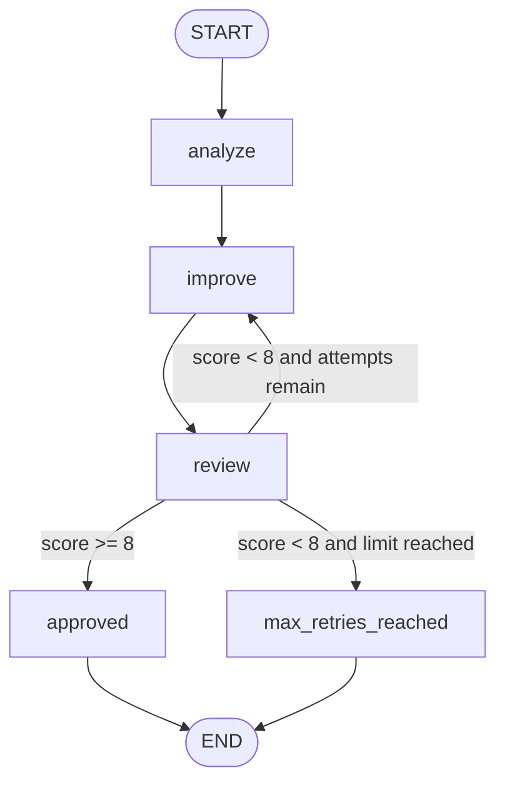

# AI Content Quality Reviewer

A stateful LangGraph application that analyzes, improves, and evaluates product descriptions with a local Ollama model. A polished Gradio interface exposes the complete multi-step workflow, including its quality score, retry count, final route, and execution trace.


## Project objectives

This project demonstrates how to:

- model an AI workflow as connected LangGraph nodes;
- share and update typed state across multiple steps;
- route execution with a conditional edge;
- cycle through an improvement loop with a strict retry limit;
- connect a real local language model to a responsive Gradio interface; and
- handle invalid input, model failures, and exhausted retries safely.

## Technologies

- **Python** — application and workflow code
- **LangGraph** — state, nodes, edges, conditional routing, and cycles
- **LangChain Core** — reusable chat prompt templates
- **ChatOllama / Ollama** — local `llama3.2` model execution
- **Pydantic** — validated structured model outputs
- **Gradio** — browser interface
- **unittest** — deterministic workflow and UI tests

## Architecture



### Nodes

| Node | Responsibility |
| --- | --- |
| `analyze` | Examines the original description and records its strengths and improvement opportunities. |
| `improve` | Rewrites the current description using the original facts, analysis, and latest review feedback. It increments the attempt counter. |
| `review` | Scores the candidate from 1–10, records feedback, and supplies the state used by the conditional edge. |
| `approved` | Sets the final status when the score reaches the approval threshold of 8. |
| `max_retries_reached` | Stops the graph with `needs_manual_review` when no attempts remain. |

### Shared state

`ProductState` is a `TypedDict` passed through every node. Nodes return partial updates rather than creating unrelated results.

| State field | Purpose |
| --- | --- |
| `product_description` | Original factual source text |
| `analysis` | Structured content analysis rendered for the interface |
| `improved_description` | Latest candidate produced by the improvement node |
| `review_feedback` | Latest quality rationale and remaining issues |
| `quality_score` | Current score from 1–10 |
| `retry_count` | Number of completed improvement attempts |
| `max_retries` | User-selected attempt limit from 1–5 |
| `status` | `pending`, `approved`, or `needs_manual_review` |
| `trace` | Reducer-backed list of graph steps and routing decisions |

### Conditional routing and retry safety

After each `review` node, `route_review()` selects exactly one path:

1. `approved` when `quality_score >= 8`;
2. `retry` when the score is below 8 and `retry_count < max_retries`; or
3. `max_retries_reached` when the limit has been reached.

The retry count is stored in graph state and incremented only by the `improve` node. The UI only accepts limits from 1–5. `run_product_review()` also supplies a defensive LangGraph recursion limit, so an accidental topology change cannot create an infinite run.

The model prompts require source-faithful copy. In addition, the review node applies a deterministic numeric-claim guard: a new number absent from the original description caps the score and prevents false approval.

## LangChain chains vs. LangGraph graphs

A **LangChain chain** normally represents a predictable sequence: one component produces output for the next component. Chains are a good fit for linear tasks such as `prompt → model → parser`.

A **LangGraph graph** models a workflow as nodes connected by edges over shared state. Edges can branch conditionally, return to an earlier node, or finish at different terminal nodes. This makes graphs a better fit for stateful processes involving decisions, retries, cycles, persistence, or human review.

This project uses both concepts together. Each Ollama operation is a small LangChain prompt/model chain inside a LangGraph node, while LangGraph controls the overall state, branching, and retry loop.

## Project structure

```text
.
├── app.py                  # Gradio interface and UI error handling
├── retry_workflow.py       # Production LangGraph workflow
├── styles.css              # Responsive visual design
├── tests/
│   └── test_workflow.py    # Routing, retry, state, guard, and UI tests
├── requirements.txt        # Reproducible Python dependencies
├── README.md
└── *.py                    # Earlier LangChain/LangGraph learning exercises
```

## Installation

### 1. Prerequisites

- Python 3.11 or newer
- [Ollama](https://ollama.com/) installed and running
- The `llama3.2` model, or another model configured through `OLLAMA_MODEL`

### 2. Create and activate a virtual environment

PowerShell:

```powershell
python -m venv venv
.\venv\Scripts\Activate.ps1
```

macOS or Linux:

```bash
python3 -m venv venv
source venv/bin/activate
```

### 3. Install dependencies

```bash
python -m pip install -r requirements.txt
```

### 4. Prepare Ollama

```bash
ollama pull llama3.2
```

Ollama normally starts its local service during installation. If it is not running, start the Ollama application or run `ollama serve` in a separate terminal.

Optional configuration:

```powershell
$env:OLLAMA_MODEL = "llama3.2:latest"
$env:OLLAMA_BASE_URL = "http://127.0.0.1:11434"
```

## Run the application

```bash
python app.py
```

Open the local URL printed by Gradio, normally [http://127.0.0.1:7860](http://127.0.0.1:7860).

1. Enter a factual product description.
2. Choose one to five maximum improvement attempts.
3. Select **Review description**.
4. Inspect the analysis, improved copy, score, feedback, final status, and expandable graph execution path.

The local `llama3.2` model can take a minute or more for a multi-attempt run, depending on the computer. Gradio displays progress while the queued workflow is running.

## Example

Input:

```text
NovaBook Pro is a 1.4 kg laptop with an AMD Ryzen 7 7840U processor,
16GB DDR5 RAM, a 512GB NVMe SSD, and a 15.6-inch 1920x1080 IPS display.
Connectivity includes Wi-Fi 6, two USB-C ports, two USB-A ports, and HDMI.
Its 70Wh battery supports mobile work, and a two-year warranty is included.
```

Expected output shape:

- a content analysis with strengths and improvement opportunities;
- a source-faithful improved description;
- quality-review feedback and a score from 1–10;
- the number of attempts actually completed;
- `approved` for a score of 8 or higher, otherwise `needs_manual_review` after the configured limit; and
- an ordered trace showing each node and conditional decision.

Exact wording and scores can vary with the installed model version.

## Testing

Run the deterministic suite without making model calls:

```bash
python -m unittest discover -s tests -v
```

The suite verifies:

- the required graph nodes exist;
- first-attempt approval;
- repeated improvement followed by approval;
- retry exhaustion and loop termination;
- every conditional route;
- state values and attempt counts;
- rejection of empty, oversized, and invalid inputs;
- numeric hallucination protection; and
- successful and failed workflow results mapped into the Gradio UI.

For a real integration check, make sure Ollama is running and use the Gradio application or run:

```bash
python retry_workflow.py
```

## Assignment criteria

| Requirement | Implementation |
| --- | --- |
| At least three nodes | Five nodes are registered in `create_workflow()`. |
| Conditional edge | `review` uses `add_conditional_edges()` with three destinations. |
| State management | `ProductState` persists content, feedback, scores, counters, status, and trace. |
| Loop or retry | `review → improve → review` repeats while attempts remain. |
| Clear retry limit | State-based 1–5 attempt cap plus a defensive recursion limit. |
| Chain vs. graph explanation | Documented above. |
| Complete practical workflow | Real Ollama calls are connected to a responsive Gradio application. |

## Limitations

- Output quality and speed depend on the installed Ollama model and local hardware.
- Language models can still produce subjective wording or inaccurate non-numeric claims. The evaluator reports suspected unsupported claims, while the deterministic guard specifically catches new numeric claims.
- The application keeps state only for the duration of one invocation; it does not persist reviews to a database.
